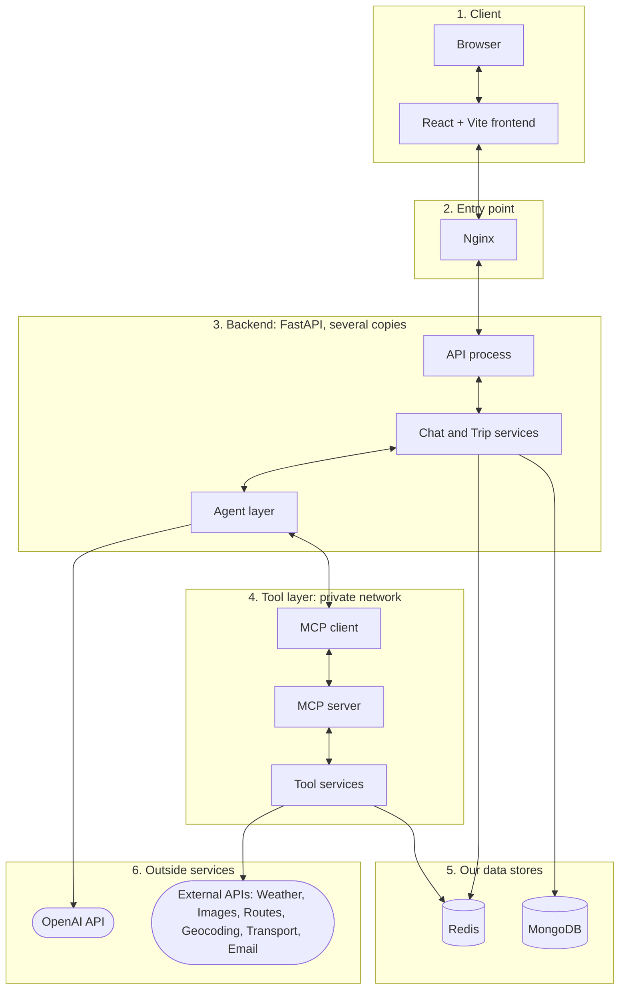
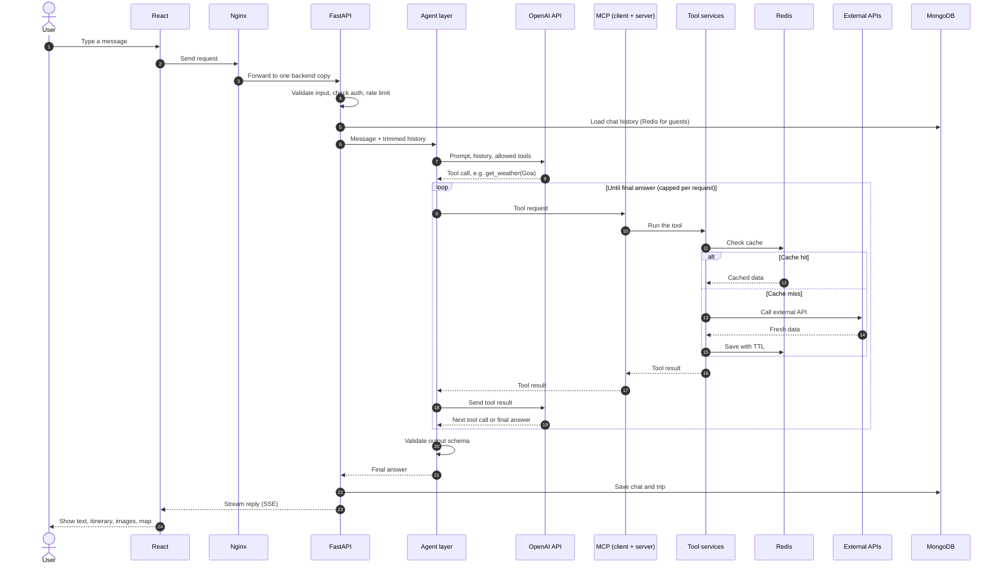
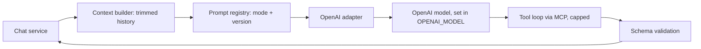

# ARCHITECTURE.md

How Trailwise is built. **Status: planned design, no code exists yet.** Everything below is the target architecture from `plan.md`. When code lands, change this file to describe what exists and mark the rest "planned". Why decisions were made, the build phases, open items and the test and launch plans stay in `plan.md`.

## 1. Shape of the system

A modular-monolith FastAPI backend, a separate React frontend, and a separate MCP tool server, backed by MongoDB (permanent data) and Redis (cache, guest chats, rate limits). Nginx is the only public entry point. There is no job queue in the MVP; every step of a chat request runs inside the request, and replies are streamed.

Reading the diagram: it shows **who talks to whom**, grouped in layers from top to bottom. Double-headed arrows form the main chain, from the user down to the tool services: a request goes down and the reply comes back up the same path. Single-headed arrows point to a resource a box simply uses (Redis, MongoDB, OpenAI, external APIs); the answer comes back automatically. Rounded boxes are outside services we call over the internet; cylinders are our own databases. The step-by-step order of one request, including the return path, is in section 3.

- **API process:** validates input (Pydantic), checks auth and ownership, loads and saves chat, calls the agent, streams the reply. Stateless; any copy can serve any request.
- **Agent layer:** understands the request, picks a mode, decides which tools to call, writes the answer.
- **MCP server:** a separate service that exposes tools. It holds the external API keys and is reachable only on the private network.
- **Frontend:** screens and forms only; no business rules and no access decisions. No API key ever reaches the browser.
- **Nginx:** TLS, load balancing, security headers, request size limits, SSE settings (`proxy_buffering off`, long read timeout).

## 2. Modules and responsibilities

Dependency direction (no upward imports): `core` ← `cache` / `auth` ← `services` ← `tools` ← `agent` ← `chat` / `trips` ← `api`. `observability` is a leaf that anything may call.

| Module | Owns | Must not |
|---|---|---|
| `core` | Settings (Pydantic BaseSettings, fails at startup if a key is missing), request ID, shared errors, clock | contain business rules |
| `auth` | Verifies the Keycloak access token (PyJWT, cached public keys), maps the token's `sub` to a user record, guest `session_id`, ownership checks. No passwords or token issuing: Keycloak does that | call the agent |
| `cache` | Redis helpers, key naming, TTL per data type, stampede lock | know about travel logic |
| `ratelimit` | slowapi setup (Redis backend), per-user and per-IP limits, global daily AI spend cap | block cached reads that cost nothing |
| `services` | One async client per external provider: weather, images, routes, places, geocoding, transport, email | talk to the agent or the database directly |
| `tools` | MCP server tool definitions, MCP client, argument validation, per-mode tool allow-list | contain provider logic (it calls `services`) |
| `agent` | Mode selection, prompts, OpenAI adapter, tool-call loop with cap, output schema validation, history trimming | write to MongoDB directly |
| `chat` | Chat endpoints, history load and save, SSE streaming | build prompts |
| `trips` | Saved trips, explore history, export and delete my data | call external APIs |
| `observability` | JSON logs, Sentry, Prometheus metrics | log secrets or message contents unnecessarily |

`agent` talks to the outside world only through `tools`. `tools` call `services`, and `services` always check `cache` first. Only three modules write to MongoDB, each to its own collections: `auth` (`users`, keyed by the Keycloak `sub`), `chat` (`ChatHistory`) and `trips` (`TripsHistory`, `ExploreHistory`). `agent`, `tools` and `services` never touch the database.

## 3. Data flow, message to saved trip

Read it top to bottom: each arrow is one step, in order. Solid arrows are requests, dashed arrows are replies.

- **Validate:** message length, language code, trip length, dates and email format are checked before anything else. Invalid input is rejected with a clear error.
- **History:** guests load from Redis, registered users from MongoDB, using the `chat_id`. Only the last N messages (or a summary) go to the model.
- **Mode and tools:** Explore, Route, Itinerary and Email each have their own prompt and their own list of allowed tools. Tool arguments are re-validated server-side before any external call. Tool calls per request are capped.
- **Caching:** every tool checks Redis first. On a miss, one request calls the provider and the rest wait on a lock (no stampede), then the result is stored with a TTL.
- **Result back to the agent:** the tool result (cached or fresh) returns through the MCP server and MCP client to the agent. The agent can then call another tool (for example weather, then routes) or, once it has enough data, write the final answer. This loop is capped per request.
- **Output:** itineraries are returned as structured JSON and validated. If invalid, retry once, then show a fallback message. Nothing invalid is saved or rendered.
- **Save and stream:** the exchange and any trip are saved, and the reply is streamed to the frontend over SSE.

## 4. API communication

- REST + JSON for all endpoints, SSE for streamed chat replies. FastAPI generates the OpenAPI schema; the endpoint list and the request, response and error formats are fixed in Phase 0 (`plan.md` section 16).
- Starting endpoint set (planned): `GET /me` (the signed-in user from the token); `POST /chat` (streaming); `GET /chats`, `GET /chats/{id}`; `GET /trips`, `GET /trips/{id}`, `DELETE /trips/{id}`; `GET /explore/history`; `POST /trips/{id}/email`; `GET /me/export`, `DELETE /me`; `GET /health`, `GET /ready`.
- One error shape for everything: `{ "error": { "code", "message", "request_id" } }`. Rate limits return HTTP 429; the frontend shows a friendly message.
- Auth (Keycloak, decided 2026-11-18): Keycloak runs as its own container and handles sign-up, login, passwords, email verification and token issuing (OpenID Connect, Authorization Code with PKCE). The frontend uses `keycloak-js` and sends the access token as `Authorization: Bearer`; it keeps the token in memory only, never in localStorage. The backend verifies the token with PyJWT (signature, issuer, audience, expiry) using Keycloak's public keys, fetched with async `httpx` and cached in Redis. Guests skip Keycloak and send a random `X-Session-Id` (32 random bytes, URL-safe; created in the browser and kept in `sessionStorage` until the backend stores guest chats, when it should issue them with `secrets.token_urlsafe(32)`). Built so far: the Keycloak container and realm file, `core/auth.py` (token check), `GET /me`, and the login pop-up. Not built: the `users` collection, chat history keyed by user or session, and a rate limit. Keycloak has its own internal store, separate from MongoDB.
- Authorization: every trip and chat endpoint checks that the record's owner equals the current user or session.
- CORS is limited to the frontend domain. In production the frontend and API sit behind Nginx on one domain so the cookie is first-party.

## 5. Data storage

Full field lists and indexes are settled in Phase 0. Overview:

**MongoDB (permanent)**

| Collection | Holds | Key fields and indexes |
|---|---|---|
| `users` | Account, hashed password, verified email, language | unique `email` |
| `ChatHistory` | Messages per chat (role, content, mode, timestamps) | `user_id`, `chat_id`, `created_at` |
| `TripsHistory` | Saved itineraries as validated JSON | `user_id`, `created_at` |
| `ExploreHistory` | Past destination searches | `user_id`, `created_at` |
| `refresh_tokens` | Hashed refresh tokens with expiry (TTL index) | `user_id`, `expires_at` |

**Redis (temporary)**

| Key pattern | Holds | TTL |
|---|---|---|
| `chat:guest:{session_id}` | Guest conversation | 1 to 24 hours |
| `weather:{city}` | Weather result | 20 to 30 minutes |
| `web_search:{query}` | Web search answer and sources (query lowercased, spaces collapsed) | 1 hour |
| `img:{query}` | Image results | 24 hours or more |
| `place:{id}` | Place details | 24 hours or more |
| `route:{hash}` | Road route, distance, time | Days |
| `geo:{place}` | Geocoding result | Days |
| `lock:{key}` | Stampede lock | Seconds |
| slowapi counters | Rate limit counts | 1 minute and up |

- Every record belongs to a `user_id` or a guest `session_id`; queries always filter by it.
- Redis may lose data on restart. Only things that can be refetched or that are allowed to expire live there (guest chat expiry is documented as acceptable). Redis has a `maxmemory` limit and an eviction policy.
- A guest's chat is either merged or discarded on registration (open item, `plan.md` section 16).
- All timestamps are UTC.

## 6. AI integration

- The rest of the app calls only the agent layer. The model name and limits come from settings, so the provider or model is swappable by configuration.
- Every call names a prompt ID and version. Mode, tools called, cache hit or miss, token counts and latency are logged per request; keys and unnecessary message content never are.
- **Modes:** Explore, Route, Itinerary and Email. Each has its own prompt and tool allow-list.
- **Grounding rule:** the system prompt says "Never state a timing or price unless it came from a tool." This is covered by a golden test.
- **Prompt-injection defense:** tool output is treated as data, not instructions; tools use least privilege (the agent can send email only when the user explicitly asked, and only to the verified address); all tool arguments are re-validated server-side.
- **Structured output:** itineraries use the Responses API structured outputs and are validated with Pydantic before saving or rendering.
- **Failures:** timeouts, 429 and 5xx use bounded retries with backoff, a circuit breaker per external API, and a friendly fallback ("weather unavailable right now") instead of failing the whole plan.
- **Cost control:** history trimming, tool-call cap, per-user rate limits, a global daily spend cap and a monthly limit in Google AI Studio (free tier has quota limits).
- AI markdown is sanitized in React; `dangerouslySetInnerHTML` is not used.

## 7. External services and tools

| Need | Provider | Status |
|---|---|---|
| LLM | OpenAI (Responses API; model names set in `OPENAI_MODEL`, `OPENAI_FALLBACK_MODEL` and `OPENAI_SEARCH_MODEL`) | Chosen |
| Weather | OpenWeatherMap | Chosen |
| Images | Pexels (attribution shown) | Chosen |
| Maps display | Leaflet + MapTiler or Stadia tiles (not public OSM tiles) | Chosen, provider to pick |
| Road routes | Self-hosted OSRM or a paid routing API (not the public demo server) | To decide |
| Geocoding | To be decided | Open |
| Transport (train, bus, flight) | To be decided; no free official API for Indian rail and bus | **Open, blocks transport tool** |
| Email | SendGrid, SES or similar | To decide |
| Voice | Browser Speech APIs with text fallback | Chosen |

- Each provider has one async client in `services`, one MCP tool in `tools`, a timeout, a circuit breaker and a Redis cache policy.
- If no transport provider is found, the transport tool returns "typical routes and durations, indicative only", labelled clearly to the user. It never invents timings or prices.
- A disclaimer shows in the UI: timings and prices are indicative, verify before travel.

## 8. Security, privacy and secrets

- Secrets live in `.env` locally (with `.env.example` committed), in a secrets manager in production, and never in code, images or the frontend. Separate keys for dev, staging and prod. `gitleaks` runs pre-commit.
- MCP server, Redis and MongoDB sit on a private Docker network with auth enabled; only Nginx is exposed.
- Email sending is rate-limited and sends only to the verified account address.
- Privacy: a retention policy, export and delete endpoints, personal data kept out of logs (India's DPDP Act and GDPR may apply).
- Dependency scanning (`pip-audit`, `npm audit`, Dependabot) runs in CI.

## 9. Deployment and operations

- Docker images for backend, MCP server and frontend (non-root, pinned versions). `docker-compose.yml` for local and staging; several backend copies behind Nginx in production.
- `/health` (liveness) and `/ready` (checks Redis and MongoDB). Graceful shutdown lets in-flight streams finish.
- MongoDB: indexes, managed service or scheduled backups, restore tested.
- CI/CD on GitHub Actions: lint, unit and integration tests, golden eval set, build, deploy, with staging and a rollback plan.
- Observability: JSON logs with a request ID, Sentry for errors, Prometheus metrics (latency, error rate, cache hit rate), alerts on error rate, p95 latency, OpenAI usage and API quota.
- Testing: pytest, a golden set of 30 to 50 prompts across all modes (including Hindi and Kannada and injection attempts) run in CI, and Locust for load.
