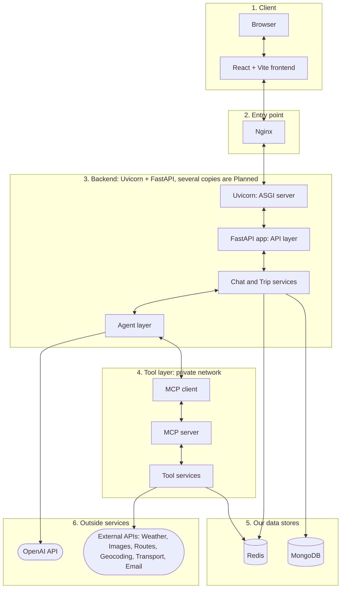
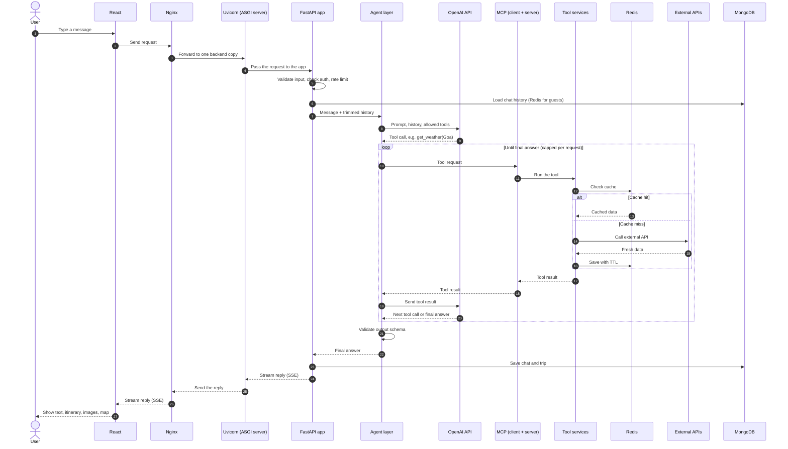
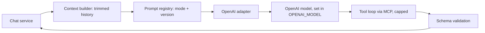

# ARCHITECTURE.md

Last updated: 2026-11-23 (checked against the code in the project folder on that date).

How Trailwise is built. The design below is the **target** from `plan.md`. Every feature and component carries a status tag so you can tell what exists and what does not. Why decisions were made, the build phases, open items and the test and launch plans stay in `plan.md`.

**Status tags (exact words):**
- **[Built]**: the code exists and does what is written. "Built" means the code was read; Docker images, Keycloak and the live providers were not run during the audit.
- **[Partial]**: some of it exists. The line says what is missing.
- **[Planned]**: nothing in the code yet. The line says what it depends on.
- **Unclear**: could not be decided from the code. Listed at the end of this file.

## Status

| Feature | Tag | Missing (Partial) or depends on (Planned) |
|---|---|---|
| Backend API: `/health`, `/ready`, `POST /chat`, `GET /me`, `GET` and `PUT /me/preferences` | [Built] | |
| Streaming chat replies (SSE) | [Planned] | An SSE route in the backend and a streaming hook in the frontend; `POST /chat` returns one JSON reply today |
| OpenAI agent: four modes, forced and required tools, capped tool loop, retries, fallback model | [Built] | |
| Itinerary as validated structured output | [Planned] | An itinerary schema (Pydantic) and the Responses API structured output; `ItineraryView` in the frontend |
| MCP tool server (8 tools) | [Built] | |
| Keycloak login (sign-up, login, token check) | [Built] | Dev mode only; a production Keycloak database is [Planned] |
| `users` record keyed by Keycloak `sub` | [Planned] | A `users` collection and a first-login hook |
| Saved preferences (page, account or browser storage, card ranking, chat language, budget style, travel mode) | [Built] | |
| MongoDB (Atlas) | [Partial] | Only the `Preferences` collection is written; no chat history, trips or explore history |
| Redis | [Partial] | Backend uses it only for Keycloak's key cache; no guest chats, no rate limits, not checked by `/ready` |
| Saved chat history and saved trips (`/chats`, `/trips`, `/explore/history`) | [Planned] | `users`, `ChatHistory`, `TripsHistory`, `ExploreHistory` collections and their routes |
| Places feed for Home and Explore | [Partial] | Six hardcoded places in `frontend/src/data/places.js`; no backend route, no real search (the Explore search is a mock) |
| Frontend app: public home, `/app` (Home, Chats, Saved, Explore, Preferences), chat, voice, photos, map panel | [Built] | The Saved panel is "coming soon" (see saved trips above) |
| Nginx as the only public entry point | [Partial] | Only `frontend/nginx.conf` (serves the built app); no TLS, proxy, load balancing or SSE settings |
| Uvicorn (ASGI server) running the FastAPI app, one process per container | [Built] | Gunicorn, several workers and several copies are [Planned] (depend on the Nginx entry point and shared state) |
| Rate limits and daily spend cap | [Planned] | A Redis-backed limiter (slowapi) and a cache module |
| Error shape `{error:{code,message,request_id}}` and request IDs | [Planned] | A shared error handler and request-ID middleware; today a bad request gets 422 with `{detail:[{loc,msg,type}]}` |
| Observability | [Partial] | JSON audit log and optional debug log exist; Sentry, Prometheus metrics and alerts are missing |
| Export and delete my data (`GET /me/export`, `DELETE /me`), retention policy | [Planned] | `users` and the history collections |
| CI/CD, lint, golden eval set, load tests | [Planned] | A `.github/` workflow, an `evals/` folder, Locust |
| Tests | [Built] | Backend 23 files / 446 test functions, MCP 9 files / 327, frontend 6 files (`node --test`: 171 pass when run). Functions were counted from the files; backend and MCP tests were not run (see Unclear) |

## 1. Shape of the system

A modular-monolith FastAPI backend, a separate React frontend, and a separate MCP tool server, backed by MongoDB (permanent data) and Redis (cache, guest chats, rate limits). Nginx is the only public entry point. There is no job queue in the MVP; every step of a chat request runs inside the request, and replies are streamed.

The diagram is the **target**. Today: nginx only serves the built frontend (the browser calls the backend directly); replies are not streamed; the MCP server is a stdio subprocess of the backend; Redis is used by the tools and for Keycloak's keys; MongoDB holds only `Preferences`.

Reading the diagram: it shows **who talks to whom**, grouped in layers from top to bottom. Double-headed arrows form the main chain, from the user down to the tool services: a request goes down and the reply comes back up the same path. Single-headed arrows point to a resource a box simply uses (Redis, MongoDB, OpenAI, external APIs); the answer comes back automatically. Rounded boxes are outside services we call over the internet; cylinders are our own databases. The step-by-step order of one request, including the return path, is in section 3.

- **Uvicorn** [Built]: the ASGI server that listens on port 8000 and hands each request to the FastAPI app. It starts from the `CMD` in `backend/Dockerfile` (`uvicorn app.main:app --host 0.0.0.0 --port 8000`), one process per container; `--reload` is used for local development only (not in the Dockerfile). Gunicorn, several workers and several backend copies are [Planned] (they depend on the Nginx entry point and on shared state in Redis or MongoDB). The Nginx to Uvicorn link is also [Planned]: today the browser calls Uvicorn on port 8000 directly.
- **API process** (the FastAPI app, running inside Uvicorn) [Built]: validates input (Pydantic), checks the Keycloak token, calls the agent, returns the reply as JSON. Stateless. Rate limits, ownership checks and chat load and save are [Planned] (they depend on Redis helpers, the `users` record and the history collections).
- **Agent layer** [Built]: understands the request, picks a mode, decides which tools to call, writes the answer.
- **MCP server** [Partial]: a service that exposes tools and holds the external API keys. Missing: today it is a stdio subprocess started by the backend in the same container and reading the same mounted `.env`, not a service on a private network.
- **Frontend** [Built]: screens and forms only; no business rules and no access decisions. No API key reaches the browser.
- **Nginx** [Partial]: planned job is TLS, load balancing, security headers, request size limits and SSE settings (`proxy_buffering off`, long read timeout). Missing: today `frontend/nginx.conf` only serves the built app and falls back to `index.html`.

## 2. Modules and responsibilities

Dependency direction (no upward imports): `core` ← `cache` / `auth` ← `services` ← `tools` ← `agent` ← `chat` / `trips` ← `api`. `observability` is a leaf that anything may call. This is the target; the real backend has only `app/agent`, `app/api`, `app/core` and `app/models`.

| Module | Tag | Owns | Must not | Missing (Partial) or depends on (Planned) |
|---|---|---|---|---|
| `core` | [Partial] | Settings (Pydantic BaseSettings, fails at startup if a key is missing), request ID, shared errors, clock | contain business rules | Exists: settings, audit and debug logs, Mongo client, preferences store. Missing: request ID, shared error shape, clock |
| `auth` | [Partial] | Verifies the Keycloak access token (PyJWT, cached public keys), maps the token's `sub` to a user record, guest `session_id`, ownership checks. No passwords or token issuing: Keycloak does that | call the agent | Exists in `core/auth.py`: token check and guest session id. Missing: `users` record, ownership checks |
| `cache` | [Planned] | Redis helpers, key naming, TTL per data type, stampede lock | know about travel logic | Depends on deciding to share one Redis helper (the tools each carry their own small helper today) |
| `ratelimit` | [Planned] | slowapi setup (Redis backend), per-user and per-IP limits, global daily AI spend cap | block cached reads that cost nothing | Depends on the `cache` module and a limiter library |
| `services` | [Planned] | One async client per external provider | talk to the agent or the database directly | Depends on moving the provider code out of `mcp_server/tools/`; those tools call providers directly today |
| `tools` | [Built] | MCP server tool definitions, MCP client, argument validation, per-mode tool rules | contain provider logic | `mcp_server/` and `agent/mcp_client.py`; provider logic is inside the tools until `services` exists |
| `agent` | [Partial] | Mode selection, prompts, OpenAI adapter, tool-call loop with cap, history trimming | write to MongoDB directly | Exists. Missing: output schema validation (depends on the itinerary schema) |
| `chat` | [Partial] | Chat endpoint, history load and save, SSE streaming | build prompts | Exists: `POST /chat`. Missing: history load and save, SSE |
| `trips` | [Planned] | Saved trips, explore history, export and delete my data | call external APIs | Depends on `users`, `TripsHistory`, `ExploreHistory` and the itinerary schema |
| `observability` | [Partial] | JSON logs, Sentry, Prometheus metrics | log secrets or message contents unnecessarily | Exists: audit log and debug log. Missing: Sentry, Prometheus |

`agent` talks to the outside world only through `tools`. `tools` call providers and check `cache` first. Target: only three modules write to MongoDB, each to its own collections: `auth` (`users`, keyed by the Keycloak `sub`), `chat` (`ChatHistory`) and `trips` (`TripsHistory`, `ExploreHistory`). Today the only writer is the preferences store (`core/preferences.py`, collection `Preferences`).

## 3. Data flow, message to saved trip

Read it top to bottom: each arrow is one step, in order. Solid arrows are requests, dashed arrows are replies. The diagram is the target; the tags below say which steps exist.

- **Entry path** [Partial]: Uvicorn and the FastAPI app are [Built] (one Uvicorn process per container). Nginx forwarding to Uvicorn is [Planned] (depends on the Nginx entry point); today the browser sends requests to Uvicorn on port 8000 directly, so the Nginx steps are not on the real path yet.

- **Validate** [Partial]: message length, history and place shapes are checked and bad input gets a 422. Missing: rate limit, and language code, trip length, date and email-format checks at the API (the tools check their own arguments).
- **History** [Partial]: the browser keeps the last messages and sends them with each request (at most 10, trimmed); the server stores none. Missing: guest history in Redis and user history in MongoDB (depends on `ChatHistory` and the `users` record).
- **Mode and tools** [Built]: Explore, Route, Itinerary and Email each have their own prompt and required tools; tool arguments are re-validated server-side; tool rounds are capped at 6 and a whole request at 180 seconds.
- **Caching** [Partial]: each tool checks Redis first when `REDIS_URL` is set. Missing: the stampede lock and a shared cache module.
- **Result back to the agent** [Built]: the tool result returns through the MCP client to the agent, which can call another tool or write the answer; the loop is capped.
- **Output** [Planned]: itineraries as validated JSON with one retry and a fallback message. Depends on the itinerary schema.
- **Save and stream** [Planned]: saving the exchange and trip and streaming over SSE. Depends on the history and trip collections and an SSE route.

## 4. API communication

- REST + JSON for all endpoints; FastAPI generates the OpenAPI schema [Built]. SSE for streamed chat replies is [Planned] (depends on an SSE route). The Phase 0 endpoint contract is in `plan.md` section 16.
- Endpoints:
  - `GET /health` [Built]
  - `GET /ready` [Partial]: pings MongoDB only; Redis check missing.
  - `POST /chat` [Partial]: one JSON reply (`reply`, `images`, `mode`, `places`); streaming missing. The caller may be a Keycloak user, a guest `X-Session-Id` or nobody.
  - `GET /me` [Built]: the signed-in user from the token.
  - `GET /me/preferences`, `PUT /me/preferences` [Built]: saved preferences, user taken only from the token, PUT replaces the whole document.
  - `GET /chats`, `GET /chats/{id}` [Planned]: depends on `ChatHistory`.
  - `GET /trips`, `GET /trips/{id}`, `DELETE /trips/{id}` [Planned]: depends on `TripsHistory` and the itinerary schema.
  - `GET /explore/history` [Planned]: depends on `ExploreHistory`.
  - `POST /trips/{id}/email` [Planned]: depends on saved trips (the email tool itself is [Built]).
  - `GET /me/export`, `DELETE /me` [Planned]: depend on `users` and the history collections.
- One error shape `{ "error": { "code", "message", "request_id" } }` and HTTP 429 rate limits [Planned]: depends on a shared error handler, request IDs and the rate limiter. Today a bad request gets 422 with `{"detail": [{loc, msg, type}]}` and never repeats the sent values.
- Auth (Keycloak, decided 2026-11-18) [Partial]. Keycloak runs as its own container and handles sign-up, login, passwords, email verification and token issuing (OpenID Connect, Authorization Code with PKCE). The frontend uses `keycloak-js`, sends the access token as `Authorization: Bearer` and keeps it in memory only. The backend verifies it with PyJWT (signature, issuer, audience, expiry) using Keycloak's public keys fetched with async `httpx` and cached in Redis. Guests skip Keycloak and send a random `X-Session-Id` kept in `sessionStorage`. Built: the Keycloak container and realm file, `core/auth.py`, `GET /me`, the frontend login. Missing: the `users` collection, chat history keyed by user or session, a rate limit, and a production Keycloak database (dev mode uses an embedded store, separate from MongoDB).
- Authorization [Partial]: `/me` routes use only the token's `sub`, and every `Preferences` query is filtered on it. Ownership checks for trips and chats are [Planned] (depend on those endpoints).
- Saved preferences in chat [Built]: `POST /chat` may carry `preferences` (reply language, budget style, travel mode; fixed values only, 422 otherwise). The agent adds one short fixed-template line after the fixed system prompt, so tools and the fixed text remain the cacheable prefix.
- CORS [Built]: limited to the frontend address (`http://localhost:5173` by default; GET, POST, PUT, DELETE). The one-domain Nginx setup for production is [Planned] (depends on the Nginx entry point).

## 5. Data storage

**MongoDB (permanent)**: Atlas only, through `MONGODB_URI` and one shared `AsyncMongoClient`. There is no MongoDB container.

| Collection | Tag | Holds | Key fields and indexes |
|---|---|---|---|
| `Preferences` | [Built] | Saved preferences per user (`travel_mode`, `budget`, `interests`, `reply_language`), one document each | unique `sub` (Keycloak id), created at startup (`core/preferences.py`) |
| `users` | [Planned] | A user record keyed by the Keycloak `sub` (no password: Keycloak owns passwords). Depends on a first-login hook | unique `sub` |
| `ChatHistory` | [Planned] | Messages per chat (role, content, mode, timestamps). Depends on `users` and the chat service | `user_id`, `chat_id`, `created_at` |
| `TripsHistory` | [Planned] | Saved itineraries as validated JSON. Depends on the itinerary schema | `user_id`, `created_at` |
| `ExploreHistory` | [Planned] | Past destination searches. Depends on a real Explore search | `user_id`, `created_at` |

`refresh_tokens` from the first design is dropped: Keycloak issues and refreshes tokens, so the app does not store them.

**Redis (temporary)**

| Key pattern | Tag | Holds | TTL |
|---|---|---|---|
| Keycloak public keys (backend) | [Built] | Keycloak's signing keys | 10 minutes |
| `web_search` cache | [Built] | Web search answer and sources | 3 hours |
| `images:v2:{hash}` | [Built] | Image results (found only) | 24 hours |
| geocode cache and 1-second slot key | [Built] | Geocoding results (found only) | 30 days; slot 1 second |
| route cache | [Built] | Road route map points | 6 hours |
| train station lookups and train searches | [Built] | RailRadar results | 30 days and 6 hours |
| `buses:v1:{hash}` | [Built] | redBus search results | 30 minutes |
| weather cache | [Planned] | Weather result. Depends on a decision to cache it (the weather tool has no cache today) | 20 to 30 minutes |
| `chat:guest:{session_id}` | [Planned] | Guest conversation. Depends on the history service | 1 to 24 hours |
| `place:{id}` | [Planned] | Place details. Depends on a places service | 24 hours or more |
| `lock:{key}` | [Planned] | Stampede lock. Depends on the `cache` module | Seconds |
| slowapi counters | [Planned] | Rate limit counts. Depends on the `ratelimit` module | 1 minute and up |

- Every record belongs to a `user_id` or a guest `session_id`; queries always filter by it. [Partial] Only `Preferences` exists, filtered by `sub`.
- Redis may lose data on restart. Only things that can be refetched or may expire live there. A `maxmemory` limit and eviction policy are [Planned] (depend on the production Redis setup).
- A guest's chat is either merged or discarded on registration (open item, `plan.md` section 16).
- All timestamps are UTC (audit log lines use India time with an offset).

## 6. AI integration

- The rest of the app calls only the agent layer. [Built] The model names and limits come from settings (`OPENAI_MODEL`, `OPENAI_FALLBACK_MODEL`, `OPENAI_SEARCH_MODEL`), never from code.
- Every call names a prompt hash and version; mode, tools called, token counts including cached tokens, and latency are logged per request, never keys or message text. [Built] (audit log). Cache hit or miss per tool is not logged: [Partial].
- **Modes** [Built]: Explore, Route, Itinerary and Email, each with its own prompt and tool rules, chosen by regex in `agent/modes.py`.
- **Grounding rule** [Built]: the system prompt says never to state a timing or price unless a tool returned it. A golden test for it is [Planned] (depends on the `evals/` set).
- **Prompt-injection defense** [Built]: tool output is treated as data; tool arguments are re-validated; the email tool can send only to one fixed address and only when `confirmed` is true and the current message asked for it.
- **Structured output** [Planned]: itineraries via the Responses API structured outputs, validated with Pydantic. Depends on the itinerary schema.
- **Failures** [Partial]: bounded retries for temporary OpenAI errors, a fallback model, per-tool timeouts and friendly fallback replies exist. Missing: a circuit breaker per external API.
- **Cost control** [Partial]: history limit (10 messages), a cap of 6 tool rounds and 180 seconds per request exist. Missing: per-user rate limits and a daily spend cap (depend on `ratelimit`). A usage limit is set on the OpenAI account, not in code.
- AI markdown is sanitized in React; `dangerouslySetInnerHTML` is not used. [Built]

## 7. External services and tools

| Need | Provider | Tag | Missing (Partial) or depends on (Planned) |
|---|---|---|---|
| LLM | OpenAI (Responses API) | [Built] | |
| Weather | OpenWeatherMap (`get_weather`) | [Built] | |
| Images | Pexels, credit shown (`get_place_images`) | [Built] | |
| Maps display | Leaflet 1.9.4, tiles from `VITE_MAP_TILE_URL` | [Partial] | Default is OpenStreetMap's public server (light use only); a production tile provider is not chosen |
| Road routes | OSRM through `ROUTING_BASE_URL` (`get_route`, map line only) | [Partial] | The public demo server is for light use only; a production routing service is not chosen |
| Geocoding | Nominatim-style service through `GEOCODE_BASE_URL` (`geocode_places`) | [Built] | |
| Transport: train | RailRadar (`search_trains`, scheduled data, indicative) | [Built] | |
| Transport: bus | redBus data via Parse.bot (`search_buses`, third-party scraped data, indicative) | [Built] | |
| Transport: flight | None | [Planned] | Depends on choosing a provider |
| Email | SMTP (`send_trip_email`) | [Partial] | Works against Mailpit locally; a real provider is not chosen and the verified-address source (the `users` record) does not exist |
| Voice | Browser Speech APIs with text fallback | [Built] | |

- Each provider has one MCP tool, a timeout and an optional Redis cache policy [Built]. A separate `services` client layer and a circuit breaker per provider are [Planned] (see section 2).
- Transport tools return only provider data or an explicit "no data" result, never invented timings or prices. [Built]
- A disclaimer shows in the UI: timings and prices are indicative, verify before travel. [Built]

## 8. Security, privacy and secrets

- Secrets live in the project-root `.env` (a template `.env.example` is committed), never in code, images or the frontend. [Built] (`.env.example` lists the settings the code reads, with fake values; updated 2026-11-23). A secrets manager in production and separate keys per environment are [Planned] (depend on a production deployment); `gitleaks` pre-commit is [Planned].
- Keys, tokens and passwords are redacted from logs. [Built]
- MCP server, Redis and MongoDB on a private Docker network with auth, only Nginx exposed. [Planned] Depends on the Nginx entry point and a production compose file. Today compose publishes Redis (6379), Mailpit, Keycloak (8080), the backend (8000) and the frontend (5173).
- Email sending goes to one fixed address and needs confirmation [Built]; a rate limit on email is [Planned] (depends on the Redis limiter).
- Privacy: retention policy, export and delete endpoints [Planned] (depend on `users` and history); personal data is kept out of logs [Built] (message text is not logged unless the local-only debug option is on).
- Dependency scanning (`pip-audit`, `npm audit`, Dependabot) in CI [Planned]. Depends on CI.

## 9. Deployment and operations

- Docker images for backend (with the MCP server inside) and frontend, non-root [Built]. A separate MCP image is [Planned] (depends on running MCP as its own service). `docker-compose.yml` runs Redis, Mailpit, Keycloak (dev mode), backend and frontend [Built]. Several backend copies behind Nginx [Planned] (depends on the Nginx entry point and shared state in Redis or MongoDB).
- `/health` (liveness) [Built]. `/ready` [Partial]: checks MongoDB only, Redis check missing. Graceful shutdown for in-flight streams [Planned] (depends on SSE).
- MongoDB: indexes [Partial] (only the `Preferences` index); managed service or backups and a tested restore [Planned] (Atlas settings, outside the code).
- CI/CD on GitHub Actions (lint, tests, golden eval set, build, deploy, staging, rollback) [Planned]. Depends on a `.github/` workflow; no lint command exists.
- Observability [Partial]: JSON audit log and optional debug log exist. Missing: JSON logs with request ID, Sentry, Prometheus metrics, alerts.
- Testing [Partial]: pytest, `node --test` and fake-provider tests exist. Missing: a golden set of 30 to 50 prompts (including Hindi, Kannada and injection attempts) in CI, and Locust load tests (depend on `evals/` and CI).

## Unclear (could not be decided from the code, for the owner)

- Whether the backend tests pass: 446 test functions were counted but pytest could not run on the author's PC (Windows Application Control blocks `pydantic_core`).
- Whether the MCP server tests pass: 327 test functions were counted, not run. The old README quoted higher numbers for four files (parametrized cases may explain it).
- Whether the Docker images and the Keycloak realm import work today: not run during the audit.
- Whether `docker-compose.override.yml` is in use: documented as optional and git-ignored, and not present in this folder.
