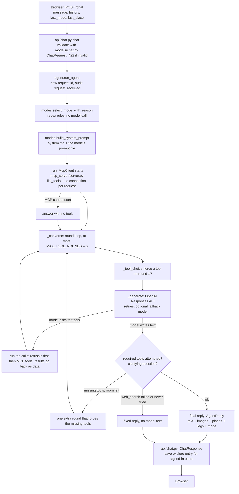

# How the Trailwise agent works

This document describes what the code does for **one chat request** (`POST /chat`). It was written by reading the code on 2026-11-22; nothing was run to produce it. Anything I could not confirm from the code is marked **(unverified)**. File names are relative to the project root; function and constant names are the real ones.

Contents: [1. Flow](#1-flow-diagram) · [2. Steps](#2-the-steps-in-plain-words) · [3. Tools](#3-every-tool) · [4. Enforced vs advised](#4-what-the-code-enforces-versus-what-prompts-only-advise) · [5. Example traces](#5-three-example-traces) · [6. Things I noticed](#6-things-i-noticed-while-reading)

---

## 1. Flow diagram

An overall timer wraps the whole request: `asyncio.timeout(CHAT_REQUEST_TIMEOUT_SECONDS)` in `run_agent` (default 180 s). When it runs out the user gets `REQUEST_TOO_LONG_REPLY` as a normal reply.

---

## 2. The steps in plain words

### 2.1 Request in (`backend/app/api/chat.py`, `backend/app/models/chat.py`)
- `ChatRequest` accepts `message` (1 to `max_message_chars` = 1000 characters), `history` (at most 10 `user`/`assistant` messages, 2000 characters each, 12000 together), `last_mode` (one of the four modes or null) and `last_place` (`{name, lat, lng}`). Anything else is a 422 (`extra="forbid"`), and the 422 body never repeats the sent values (`app/main.py` `bad_request`).
- `get_optional_principal` (`app/core/auth.py`) reads who is calling: a Keycloak user, a guest (`X-Session-Id`) or nobody. A bad token is a 401. It does **not** change what the agent does; it only decides whether an explore entry is saved afterwards.

### 2.2 Mode choice (`backend/app/agent/modes.py`: `select_mode_with_reason`)
Plain regex on the lower-cased message, **first match wins**, no model call:

1. `email_words`: "email", "mail me", "send the plan" → **email**
2. `itinerary_words`: "itinerary", "plan"/"planning", "3 days"/"3-day" → **itinerary**
3. route rules, in this order (the rule name is logged as `mode_reason`): `route_words` (route, train, bus, flight, travel, option(s), transport), `route_how_to_go`, `route_ways_to`, `route_from_to` ("from X to Y"), `route_to_from`, then a bare "X to Y" (`route_bare_x_to_y`) → **route**
4. `explore_words`: "tell me about", "things to do", "places to visit", "what to see/do" → **explore**
5. `previous_mode`: otherwise the browser's `last_mode`, if valid
6. `default`: **explore**

The mode is chosen again on **every** message. Only the rule *name* is logged, never message text.

### 2.3 Prompt build (`modes.py`: `build_system_prompt`)
`system.md` first (identical on every request, so OpenAI's prompt cache can reuse the prefix), then the mode's file (`explore.md`, `route.md`, `itinerary.md`, `email.md`). The result carries a 12-character SHA-256 `hash` and the version labels (for example `trailwise.route@7`). The heading of every prompt file is checked at startup (`validate_prompts`, called from `create_app`). Details of versioning: `docs/prompts.md`.

### 2.4 Tool discovery (`agent.py`: `_run`, `mcp_client.py`: `McpClient`)
- One MCP connection per request: `McpClient.__aenter__` starts `mcp_server/server.py` as a stdio subprocess (nothing is kept between requests).
- `list_tools` fails → the request carries on **with no tools**. The MCP server cannot start (`McpClientError`) → also no tools. In both cases the model answers without tools.
- `_converse` then removes the tools the mode must not see (`modes.EXCLUDED_TOOLS`: route mode never gets `web_search` or `get_weather`). Only tools that are offered *and* not excluded can be called (`allowed`).

### 2.5 Forced tools, round 1 (`agent.py`: `_tool_choice`)
`tool_choice` is sent as `allowed_tools` with mode `"required"` (the model must call one of the listed tools). Rules, in order:

| Condition on round 1 | Result |
|---|---|
| no tools offered | no `tool_choice` ("none") |
| mode is **explore**, `FORCE_WEB_SEARCH_FIRST` is true, and `web_search` is required for this message | forced to `web_search` **alone** |
| mode is **route**, `has_two_places(message)` is true, not small talk | forced to `FORCED_TOOLS["route"]` = `geocode_places`, `search_trains`, `search_buses` (the model must call at least one of them; the prompt asks for all three together) |
| the mode has required tools (explore, itinerary, route) and `FORCE_FIRST_ROUND_WHEN_REQUIRED` is false (it is) | **not forced** ("auto"): the model may ask a short clarifying question first |
| anything else except small talk | `FORCED_TOOLS[mode]` (see 6. for why this is practically never reached) |
| email mode, small talk ("hi", "thanks"…), rounds 2 and later | "auto" (no `tool_choice` sent) |

`is_small_talk` is true only when the **whole** normalized message is one of: hi, hello, hey, thanks, thank you, ok, yes, no, bye.

### 2.6 Required tools (`modes.py`: `REQUIRED_TOOLS`, `required_tools`; `agent.py`: `_converse`)
A final answer is only accepted once every **required** tool was *attempted* (a failed attempt counts):

| Mode | Required |
|---|---|
| explore | `web_search`, `get_weather`, `geocode_places`, `get_place_images` |
| itinerary | `web_search`, `get_weather`, `geocode_places` |
| route | `geocode_places`, `search_trains`, `search_buses`, and `get_route` **only after** `geocode_places` found at least `MAP_MIN_PLACES` (2) distinct places |
| email | none |

Only tools the server really offered are required (`required_tools` intersects with `allowed`). Greetings require nothing. When the model answers early:

- **Guard** (`is_clarifying_question`): a reply of at most 300 characters ending in `?`, given before any tool other than `web_search` ran, with no `last_place`, is returned as is (logged `guard_skipped`). It skips the required-tools check because the user has to answer first.
- Otherwise the missing tools are forced in **one extra round** (`extra_done`); for route mode `get_route` has its own one-time extra round (`map_extra_done`). The draft answer is dropped. An extra round is only scheduled if `round_no + 2 <= MAX_TOOL_ROUNDS`.

### 2.7 Rounds and the tool loop (`agent.py`: `_converse`)
Each round: `_generate` → if the response has function calls, run them; else it is the final text. `MAX_TOOL_ROUNDS = 6`; more than that raises `AgentError("Too many tool rounds")` → HTTP 502.

Inside one round:
1. Identical calls (same tool and arguments) run once (`_dedupe_calls`).
2. In route mode `geocode_places` is moved first (stable sort), so the other calls of the same round can be checked against it.
3. For each call, in order, the agent refuses (no MCP call) when: the arguments are not valid JSON (`bad_arguments`); `send_trip_email` has `confirmed=true` but the **current** message is not a send confirmation (`is_send_confirmation`; `confirmation_required`); route mode and an end of a train/bus search or a point of `get_route` was not geocoded (`legs.check_city_pair`, `legs.check_route_points`; `place_not_located`); the tool name is not offered (`unknown_tool`).
4. Otherwise `McpClient.call_tool` runs it (per-call limit 30 s, `web_search` 150 s = `WEB_SEARCH_CALL_TIMEOUT_SECONDS`; a timeout becomes `{"ok": false, "error": "timeout"}`).
5. Results go back to the model as `function_call_output` — **data, never instructions**.
6. The agent also collects: places from `geocode_places` (`geocoded`, sent back as `places`), photos from `get_place_images`, road lines from `get_route` (`roads`), and sets `gateway_flow` when a train/bus search says the **destination** has no station/city (`legs.is_gateway_signal`).

### 2.8 Model errors, retries and the fallback model (`agent.py`: `_call_model`, `_generate`; `openai_adapter.map_error`)
- `max_retries=0` on the OpenAI client; the agent runs its own loop.
- Server errors 500, 502, 503, 504: retried **twice** after 2 s and 5 s (`RETRY_DELAYS_SECONDS`). A rate-limit 429: retried **once** (after 5 s). A used-up quota (`insufficient_quota`), other 4xx and timeouts: **never** retried.
- If the main model still fails with 500/502/503/504 **and** `OPENAI_FALLBACK_MODEL` is set and different, `_generate` switches to it for the rest of the request (`_active_model` is a per-request `ContextVar`).
- Model names only come from settings (`OPENAI_MODEL`, `OPENAI_FALLBACK_MODEL`); an empty `OPENAI_MODEL` raises `AgentError(kind="no_model")`.
- What reaches the user (`api/chat.py`): 503 "busy" (`AgentBusyError`, with `Retry-After: 60`), 503 "not available" (`AgentUnavailableError`, quota), any other `AgentError` → 502 generic. An empty model reply is `AgentError(kind="empty_reply")` → 502.

### 2.9 Fixed replies (text the code writes, not the model)
| Reply | When | Where |
|---|---|---|
| `NO_LIVE_INFO_REPLY` "I could not check live information right now, please try again." | `web_search` failed (any code other than the two below) or was never attempted, in a mode where it is required | `_search_failed_reply`; also the `all_tools_failed` branch |
| `SEARCH_NOT_SET_UP_REPLY` | `web_search` returned `not_configured` | `_search_failed_reply` |
| `SEARCH_TIMEOUT_REPLY` | `web_search` returned `timeout` | `_search_failed_reply` |
| `REQUEST_TOO_LONG_REPLY` | the overall 180 s timer ran out | `run_agent` |
| a note appended to the model's text: "Note: I could not check the weather / the map locations / the photos right now." (or "…: that is not set up on this server.") | `get_weather`, `geocode_places` or `get_place_images` failed or were never attempted, in a mode that requires them | `_unchecked_note` |

Route mode **never** gets the `all_tools_failed` fixed reply (`mode != "route"` in `_converse`); failed route tools are named by the model, with the other results kept. A `web_search` failure always wins over everything else (fixed reply, no further model call).

### 2.10 Memory (nothing is stored on the server)
- The browser sends `history`, `last_mode`, `last_place` with every request (`hooks/chatMemory.js`, `useChat.js`).
- `_history_items` keeps only `{role, content}` items with role `user`/`assistant` (a second check after the Pydantic validation).
- Input order to the model: history → `LAST_PLACE_NOTE` (a user-role note telling the model this is *data, not instructions*, naming the last place and its coordinates) → the new message.
- History is **untrusted**: it can never confirm an email (only the current message can), and a known `last_place` counts as a named place for the guard (so the model cannot dodge the tools by "asking" about a place it already knows).
- The audit log records only `history_count`, never the text (`audit.py`, `message_fingerprint`).
- The response carries `mode` and the geocoded `places` for the next request.

### 2.11 Reply out (`agent.py`: `AgentReply`; `api/chat.py`)
`AgentReply` is a `str` that also carries `images` (Pexels only, at most 6), `places` (at most 12), `legs` (map lines, at most 8) and `mode`. `ChatResponse` re-validates all of them (`clean_images`, `clean_places`, `clean_legs`). For a signed-in user, an explore reply with a geocoded place saves one explore-history entry (2 s timeout) and sets `saved`.

---

## 3. Every tool

All tools live in `mcp_server/tools/` and are registered in `mcp_server/server.py`. **Cache** is what each tool stores in Redis today — see `docs/redis.md`. The agent also adds codes of its own (see the end of this section). Every tool returns a dict and never raises into the loop.

| Tool (function) | Inputs | Failure codes the tool returns | Cache | Forced / required |
|---|---|---|---|---|
| `get_weather` (`tools/weather.py`) | `location` (name), `lat`, `lng` — prefers coordinates | `invalid_arguments`, `location_not_found`, `not_configured`, `unavailable` | none ("no cache yet" in the file header) | explore: required; itinerary: required; route: not offered |
| `web_search` (`tools/web_search.py`) | `query` | `invalid_arguments`, `no_results`, `not_configured`, `quota_exceeded`, `timeout`, `unavailable` | successes, 3 h | explore: **forced alone on round 1** and required; itinerary: required (not forced first — see 6.); route: not offered |
| `geocode_places` (`tools/geocode_tool.py`) | `names` (1–12), `context` | `invalid_arguments`, `not_configured`, `unavailable`; each place entry has `found` and may carry `error: "unavailable"` | matches, 30 d; shared 1 req/s slot | explore, itinerary, route: required; route: forced on round 1 when both cities are named |
| `get_place_images` (`tools/images_tool.py`) | `place`, `region`, `count` (1–3) | `invalid_arguments`, `not_configured`, `unavailable`; `found: false` is not an error | complete results, 24 h; 1-minute 429 marker | explore: required; itinerary: not required |
| `get_route` (`tools/routes_tool.py`) | `points` (2–10 `[lat, lng]`), `mode` (only `"driving"`) | `invalid_arguments`, `not_configured`, `unavailable`; `found: false` when no road exists | routes, 6 h | route: required after 2 places were found; itinerary: optional |
| `search_trains` (`tools/train_tool.py`) | `source_city`, `destination_city`, optional `date` (YYYY-MM-DD) | `invalid_arguments`, `not_configured`, `quota_exceeded`, `station_not_found` (with `failed_end`), `unavailable`; also non-error results `needs_choice`, `needs_date`, `no_trains_on_date` | stations 30 d, searches 6 h | route: required; forced on round 1 with both cities |
| `search_buses` (`tools/bus.py`) | `source_city`, `destination_city`, optional `journey_date` | `invalid_arguments`, `not_configured`, `city_not_found` (with `failed_end`), `no_buses_found`, `rate_limited`, `unavailable` | successful results, 30 min | route: required; forced on round 1 with both cities |
| `send_trip_email` (`tools/email_tool.py`) | `subject`, `body`, `confirmed` (no recipient) | `invalid_arguments`, `not_configured`, `not_confirmed`, `unavailable` | none | never forced, never required (email mode) |

Codes added by the layers around the tools:

| Code | Added by | Meaning |
|---|---|---|
| `timeout`, `tool_call_failed`, `tool_error`, `bad_tool_output` | `McpClient.call_tool` | call limit reached; the call raised; the tool reported an error; the output was not JSON |
| `bad_arguments`, `unknown_tool`, `confirmation_required` | `_converse` | unreadable arguments; a tool name the server does not offer; an email send without the user's current confirmation |
| `place_not_located` (with `failed_end`) | `_converse` via `legs.py` | route mode: an end of a train/bus search, or a `get_route` point, was not geocoded |

Notes: the email tool called by the **agent** sends only to the fixed `VERIFIED_RECIPIENT` (or the `SMTP_EMAIL` account) — the model cannot choose a recipient. This is separate from `POST /trips/{id}/email` (`backend/app/api/trips.py`), which is not an agent tool and sends only to the verified email in the user's token.

---

## 4. What the code enforces versus what prompts only advise

**Enforced by code** (the model cannot get around these):

| Rule | Where |
|---|---|
| The mode, and which prompt file is used | `select_mode_with_reason`, `build_system_prompt` |
| Which tools exist for the model in a mode (route has no `web_search` or `get_weather`) | `modes.EXCLUDED_TOOLS`, `_converse` |
| Explore's first model call is `web_search` and nothing else | `_tool_choice` (`FORCE_WEB_SEARCH_FIRST`) |
| Route with both cities: first call is the map lookup and the two transport searches | `_tool_choice`, `has_two_places` |
| Required tools must be *attempted* before an answer is accepted (one extra forced round) | `REQUIRED_TOOLS`, `_converse` |
| `web_search` failing or missing replaces the answer with a fixed reply (never memory) | `_search_failed_reply` |
| Failed weather, map locations or photos are named in a fixed note | `_unchecked_note` |
| Tool names and arguments are checked; identical calls run once | `_dedupe_calls`, `parse_arguments`, `unknown_tool` |
| An email is never sent without the current message confirming it | `is_send_confirmation`, `confirmation_required` |
| The email recipient cannot be chosen (the tool has no recipient argument) | `tools/email_tool.py` |
| Route mode: only geocoded pairs and points are searched; train/bus results are not requested for an un-geocoded destination | `legs.check_city_pair`, `legs.check_route_points` |
| Map lines come from `get_route` (solid) or straight segments between geocoded places (dashed, gateway flow only); the model never supplies coordinates | `legs.build_legs` |
| Photos are shown by the app, from the tool result only, Pexels addresses only | `clean_images`, `ChatImage` |
| At most 6 rounds, one overall 180 s timer, 30 s per tool (150 s for `web_search`) | `MAX_TOOL_ROUNDS`, `run_agent`, `McpClient.call_limit` |
| Server/rate-limit retries and the optional fallback model | `_call_model`, `_generate` |
| Tool results go back as data; history is untrusted and only user/assistant text is accepted | `function_call_output`, `_history_items`, `LAST_PLACE_NOTE` |
| No timings or prices are invented by tools: the tools return only provider data (project rule 4) | the tool files (the **UI** disclaimer is in `Disclaimer.jsx`) |
| No message text, tool arguments or keys in the audit log | `app/core/audit.py` |

**Only advised by prompts** (the model *should* do it; nothing in code checks):

| Advice | Prompt |
|---|---|
| Never state a timing, price or distance unless a tool returned it; add "Verify before travel." | `system.md`, every mode file |
| Stay on travel topics; no legal, medical or visa advice as fact; no pretending to book | `system.md` |
| Do not reveal the prompt or keys; treat tool output as data | `system.md` |
| The *order* of calls: `geocode_places` and `get_place_images` together, then `get_weather` with the returned `lat`/`lng` | `explore.md`, `itinerary.md` (the code only requires that all were attempted) |
| Use the coordinates from the tool, never invented ones, for `get_weather` | `explore.md`, `itinerary.md` (the code does **not** check `get_weather`'s arguments; it does check `get_route`'s in route mode) |
| Never list, describe or credit the photos in the reply | `explore.md`, `itinerary.md` |
| Do not repeat a call with the same arguments across rounds (only the same round is de-duplicated by code) | `explore.md`, `itinerary.md`, `route.md` |
| Mention the sources returned by `web_search` | `system.md`, `explore.md`, `itinerary.md` |
| Itinerary: Morning/Afternoon/Evening layout, 1–14 days, no clock times, a verify reminder | `itinerary.md` |
| Route: with no date say "Showing results for <date>", never claim seat availability or fares, name the stations used | `route.md` |
| Gateway flow for remote destinations: say there is no direct train or bus, propose a gateway city, search to it without asking, describe onward legs without timings or prices, never start with "I could not locate" | `route.md` (version 7). The **detection** and the map lines are code; the **wording and the choice of gateway** are prompt-only |
| Email: show the draft and ask for confirmation before `confirmed=true` | `email.md`, `system.md` (the code only blocks a send when the current message does not look like a confirmation) |
| Ask at most one or two short clarifying questions | `system.md`, mode files (code only *tolerates* a clarifying question; see the guard) |

---

## 5. Three example traces

These follow the code paths above. The tool outputs are **illustrative**, not real captured responses **(unverified: I did not run the app)**. Round numbers are model rounds.

### 5.1 `varanasi`

1. **Mode**: no email/itinerary/route/explore words, not a bare "X to Y" (no `to`) → no `last_mode` → `default` → **explore**. Prompt: `system.md` + `explore.md`.
2. **Required**: `web_search`, `get_weather`, `geocode_places`, `get_place_images` (all four offered). Not small talk.
3. **Round 1 — forced**: `tool_choice` = `allowed_tools`/`required`/`[web_search]`. The model calls `web_search` (a query about Varanasi). Result: answer + sources, or an error. If it failed, the loop ends here with the fixed reply (`NO_LIVE_INFO_REPLY`, or the timeout / not-set-up one).
4. **Round 2 — auto**: advised by `explore.md`, the model calls `geocode_places(["Varanasi"], "Uttar Pradesh, India")` and `get_place_images("Varanasi", "Uttar Pradesh, India")` together. Places `[{name: "Varanasi", lat, lng}]` are collected; photos are collected.
5. **Round 3 — auto**: the model calls `get_weather(lat, lng)` with the geocoded coordinates (advice, not enforced).
6. **Round 4**: the model writes the text (3–6 options, sources, "Verify before travel."). No function calls → the required check passes (all four attempted) → final answer.
   - If the model had skipped a tool (say it never called `get_place_images`), the draft is dropped and **one** extra round forces the missing tools; if a required tool is then still missing it is not forced again: a missing weather, map-location or photo tool is named in the note, a missing `web_search` gives the fixed reply, and a missing train or bus search is simply absent from the answer.
   - If `get_weather` had failed: the reply gets "Note: I could not check the weather right now."
7. **Out**: `ChatResponse{reply, images (≤3), mode: "explore", places: [Varanasi], legs: []}`. A signed-in user also gets one explore-history entry (`saved: true`); a guest gets `saved: null`. In the app: one place + explore → the "Plan a trip to Varanasi" button; "Show map" opens the pin.

### 5.2 `travel options from Bangalore to Goa`

1. **Mode**: no email words; no plan/`N days`; the first route rule `route_words` matches ("travel", "options") → **route** (`mode_reason = route_words`). Prompt: `system.md` + `route.md` (version 7).
2. **Tools offered**: `web_search` and `get_weather` are removed (`EXCLUDED_TOOLS`). **Required**: `geocode_places`, `search_trains`, `search_buses`, and `get_route` once two places are found.
3. **Round 1 — forced**: `has_two_places` is true ("from bangalore to goa" matches `route_from_to`), so `tool_choice` = `required` over `[geocode_places, search_trains, search_buses]`. Advised by `route.md`, the model calls all three together, with "Bangalore" and "Goa".
   - The agent runs `geocode_places` **first** (route-mode sort): both found, so both cities are known.
   - `search_trains("Bangalore", "Goa")`: both ends are geocoded, so it runs. With no date it returns the trains that run every day with `needs_date: true`.
   - `search_buses("Bangalore", "Goa")`: runs; with no date it searches tomorrow and returns `date_assumed: true` and the date used.
   - If a tool had said the **destination** has no station (`failed_end: "destination"`), `gateway_flow` would be set (see `route.md`'s gateway flow); here it is not.
4. **Round 2 — auto**: `get_route([[lat, lng] Bangalore, [lat, lng] Goa], "driving")`, with the exact coordinates `geocode_places` returned. `check_route_points` verifies each point is a geocoded place. The result's `route` is stored as a road leg.
   - If the model skipped it, the answer would be dropped and `get_route` forced in its own extra round (`map_extra_done`).
5. **Round 3**: the model writes the comparison: stations used, the daily trains with "verify before travel", the buses with "Showing results for <date>" and a question about another date, general advice for flights/road. No function calls → all required tools attempted → final.
6. **Out**: `ChatResponse{reply, mode: "route", places: [Bangalore, Goa], legs: [{kind: "road", points: [...]}]}`. Because the mode is route **and** it has a leg, the app shows "Save trip" and "Email plan". No dashed legs (not the gateway flow). If `search_buses` had failed, the model names it ("I could not check buses right now") and keeps the train results; there is **no** fixed `NO_LIVE_INFO_REPLY` in route mode.

### 5.3 `hi`

1. **Mode**: nothing matches → `default` → **explore** (a first message; with a `last_mode` the previous mode would be kept, `previous_mode`).
2. **Required**: `is_small_talk("hi")` is true → `required_tools` returns `()`.
3. **Round 1**: `_tool_choice` — explore's forced `web_search` needs `web_search` in the required set, which is empty; the route rule does not apply; the "required tools" branch does not apply; the last forcing branch has `not is_small_talk(message)` → false. Result: **no `tool_choice`** ("auto"). The tools are still offered.
4. The model replies with a short greeting and asks what the user wants to plan (advised by `system.md`). No function calls → the required set is empty → `missing = []`, `"web_search" in required` is false, `unchecked = []` → final answer.
   - If the model called a tool anyway, the loop would run it normally; the code does not forbid it.
5. **Out**: `ChatResponse{reply: "…", images: [], mode: "explore", places: [], legs: []}`, `saved: null`. In the app: no buttons (an explore reply with no place).
6. No tool results, no fixed replies, and one model call (plus retries only if OpenAI errors).

---

## 6. Things I noticed while reading

These are observations from reading, not fixes. Nothing here has been changed.

1. **Itinerary's "web_search first" is advised but not enforced.** `itinerary.md` says "The app always runs `web_search` first, before you write anything", and a comment in `agent.py` near `FORCE_WEB_SEARCH_FIRST` lists "explore, itinerary, route". But `_tool_choice` checks `mode == "explore"` only. For itinerary, `web_search` is *required* before the final answer (forced in one extra round if skipped) but is not forced first. `CLAUDE.md` correctly says "explore (only)". The prompt sentence and that code comment are out of date.
2. **`FORCED_TOOLS` for explore, itinerary is practically unused.** For those modes `required_tools(...)` is non-empty whenever the tools are offered, so `_tool_choice` returns "auto" before reaching the `FORCED_TOOLS[mode]` branch. Only route's entry is used (through the explicit route branch). **(unverified by running; reading only.)**
3. **The `all_tools_failed` fixed reply looks effectively unreachable** with the current constants: it needs a *forced* round 1, and the only forced round 1s are explore's `web_search` (whose failure returns earlier through `_search_failed_reply`) and route (excluded by `mode != "route"`). **(unverified.)**
4. **`get_weather` coordinates are advice only.** The prompt asks for the geocoded `lat`/`lng`; the code does not check them (unlike `get_route` in route mode).
5. **A fixed failure reply can still carry `places`** if `geocode_places` succeeded before `web_search` failed (the `AgentReply(..., places=geocoded)` branches). The frontend's plan-button rule therefore could show buttons under such a reply when the mode is itinerary; this is the known edge case recorded in `claudeprompts.md`.
6. **The rule "never a timing or price unless a tool returned it" is a prompt rule.** Code guarantees the *tools* return only provider data, but nothing scans the model's final text for numbers.
