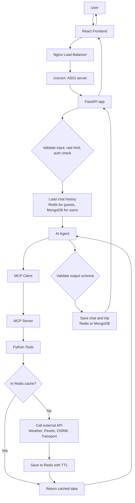

# Trailwise: Project Plan

**Trailwise** is an Agentic AI travel planner. Users chat in plain language, and an AI agent finds travel information, builds itineraries, and shows maps, weather, and images.

---

## Progress Remarks (last updated 2026-11-24)

Based on reading the code, not running it. Details per file are in ARCHITECTURE.md, FILE_STRUCTURE.md and README.md.

### Built (code exists)

- Chat endpoint `POST /chat` with the OpenAI agent: 4 modes (Explore, Route, Itinerary, Email) and an MCP tool loop.
- MCP server (stdio subprocess of the backend) with 8 tools: get_weather, web_search, search_trains, search_buses, send_trip_email, geocode_places, get_route, get_place_images.
- Keycloak login: `keycloak-js` in the frontend, JWT check in the backend (`GET /me`), guest mode alongside.
- Saved Preferences: `GET/PUT /me/preferences`, MongoDB `Preferences` collection (unique `sub` index), frontend page, interest ranking, saved language used by the agent and voice. Guests keep preferences in localStorage.
- Health endpoints `/health` and `/ready`.
- React frontend: chat, Leaflet map panel, voice input, Explore page.
- Docker Compose: redis, mailpit, keycloak, backend, frontend (nginx-unprivileged serving the built app).
- Saved trips and explore history for signed-in users: `/trips`, `/explore-history`, `DELETE /me/data`, MongoDB `trips` and `explore_history` (`owner_id` = token `sub`).
- Reply buttons under plan and explore replies (Save trip, Email plan, Plan a trip to...), a guest login popup, and `POST /trips/{id}/email` to the verified address (5 per user per hour, Redis counter).
- Gateway flow for remote destinations (map legs, dashed suggested connections).
- Tests written: backend 26 files, MCP 9 files, frontend 7 files. Run on 2026-11-24 after the merge: backend 917 passed and 1 failed, MCP 609 passed, frontend 207 passed, `npm run build` works.

### Partial (works in part, something is missing)

- Redis: container exists in compose, but chat and cache data are not stored there yet (Phase 2).
- Explore page: the place search is a mock over 6 hardcoded places in `frontend/src/data/places.js`; no places endpoint yet.
- Unused frontend files: `SavedTrips.jsx` and `Login.jsx` exist but nothing uses them.
- One backend test fails: `test_only_the_override_file_mounts_the_debug_logs` reads the git-ignored `docker-compose.override.yml`, which is not in this folder.

### Still in process / Planned (not created yet)

- Saved chat history in MongoDB (`ChatHistory`) and a `users` record. Depends on: the data model and API spec (Section 10). Trips and explore history already exist (above); the Saved panel in the app is not connected to them yet.
- Guest chats in Redis with TTL; caching of weather, images and places. Depends on: Redis wiring (Phase 2).
- General rate limiting (slowapi on Redis, chat limits, daily spend cap). Depends on: Redis wiring. Only the trip email route is limited today (5 per user per hour).
- Streaming replies (SSE) and an itinerary view. Depends on: structured itinerary output.
- Nginx load balancer config, MCP server as its own Docker service. Depends on: Dockerfiles and the Phase 6 deploy design.
- CI (GitHub Actions) and the golden eval set. Depends on: runnable tests and the transport decision.
- Curated place fields (budget_style / access), saved preferences step 5: dropped for now by decision; only user interests are used.
- Monitoring (Sentry, Prometheus) and Locust load test (Phase 7).

### Unclear / open decisions

- Real transport data source (Section 10, gap 1): the train/bus tools exist, but whether their data is real and sufficient is undecided.
- Whether the Docker images and the Keycloak realm import work end to end (not run).
- Whether `docker-compose.override.yml` is used (no such file in the folder).

---

## 1. What Is This Project For?

Planning a trip means jumping between many websites: one for weather, one for trains and buses, one for places to visit, another for maps. It is slow and confusing.

Trailwise puts everything in **one chat**. The user types something like *"Plan a 3-day trip to Goa from Bangalore"*, and the AI agent does the rest.

**Who uses it:** travelers (guests or registered users) who want quick, simple trip planning.

**What it does:**
- Explore destinations and nearby attractions
- Find train, bus, and flight options
- Create day-by-day itineraries
- Show weather, images, and maps
- Voice input (English, Hindi, Kannada) and email of trip plans
- Save trips and chat history

**What it does not do:** booking, payments, or tickets. It is an information and planning tool only.

---

## 2. Problem Statement

**Main problem:** travel planning is scattered across many tools, and it takes too much time and effort.

**Technical problems we also solve (for many users at once):**
- Chats are lost when the session ends or the server restarts
- The server must not store user data in memory, or it cannot scale
- AI and API calls are slow, costly, and rate-limited
- One user can use up the whole API quota
- There is no monitoring to see what is slow or failing

**Goal:** a simple conversational travel assistant that is fast, reliable, secure, and works for many users at the same time.

---

## 3. Overall Tech Stack

| Layer | Technology | Why we use it |
|---|---|---|
| Frontend | React + Vite | Fast, simple UI for chat, maps, and itinerary |
| Backend | Python + FastAPI | Quick to build, async, great for APIs and AI work |
| AI Agent | OpenAI (Responses API, function calling) | Understands user requests and decides which tools to use |
| Tool communication | MCP (Model Context Protocol) | Standard way for the agent to call tools |
| Database | MongoDB | Flexible storage for trips, chats, and history |
| Cache / sessions | Redis | Very fast memory store for cached API data, guest chats, and rate limits |
| Maps | Leaflet + a proper tile provider (MapTiler or Stadia) | Free, easy map display; public OSM tiles must not be used for heavy traffic |
| Road routes | OSRM (self-hosted) or a paid routing API | Public OSRM demo server is not allowed for production |
| Weather | OpenWeatherMap API | Reliable weather data |
| Images | Pexels API | Free destination photos (attribution required) |
| Transport data | **To be decided (see Section 10)** | Trains, buses, flights need a real data source |
| Email | **To be decided** (SendGrid, SES, etc.) | Sending trip plans |
| Voice | Browser Speech APIs | Built in, no extra cost (uneven support, see Section 16) |
| Authentication | Keycloak (OIDC login; `keycloak-js` in the frontend, PyJWT token check in the backend) + guest session_id (changed 2026-11-18, replaces our own JWT cookies) | Keeps each user's or guest's chat separate |
| Config / secrets | Pydantic BaseSettings + secrets manager | Safe handling of keys |
| Validation | Pydantic models + structured outputs | Reject bad input and bad AI output |
| Rate limiting | slowapi (Redis backend) | Stops overuse of the app and APIs |
| Deployment | Docker + Nginx | Easy to run multiple copies and balance traffic |
| CI/CD | GitHub Actions | Lint, test, eval, build, deploy |
| Testing / evals | pytest, golden prompt set, Locust | Correctness and load |
| Monitoring | Structured JSON logs, Sentry, Prometheus | Find slow spots and failures |

---

## 4. Framework (How the Project Is Organized)

A simple layered design. Each layer has one job.

| Layer | Job |
|---|---|
| **Frontend (React)** | Chat screen, maps, images, itinerary display |
| **API layer (FastAPI)** | Receives requests, validates input, checks the user, loads and saves chat, returns the response |
| **Agent layer (OpenAI)** | Understands the request and picks a mode: **Explore, Route, Itinerary, or Email** |
| **Tool layer (MCP client + server)** | Agent calls tools in a standard way |
| **Services layer (Python tools)** | Weather, transport search, place details, images, email |
| **Data layer (Redis + MongoDB)** | Redis for temporary data, MongoDB for permanent data |

**Three simple rules:**
1. **Stateless servers:** no user data is kept in server memory. It lives in Redis or MongoDB.
2. **Async everywhere:** one server can handle many users while waiting on APIs.
3. **Cache first:** check Redis before calling any external API.

**Where data is stored:**

| Data | Storage | How long |
|---|---|---|
| Guest chat | Redis | 1 to 24 hours (auto-deletes) |
| Registered user chat | MongoDB (`ChatHistory`) | Persistent |
| Saved trips | MongoDB (`TripsHistory`) | Persistent |
| Explore history | MongoDB (`ExploreHistory`) | Persistent |
| Weather, images, place details | Redis | Minutes to hours |

---

## 5. Simple Flow Diagram

### 5.1 Overall system



### 5.2 Same flow in plain text

```
User types a message
   ↓
React sends it to the backend (through Nginx)
   ↓
Nginx passes it to Uvicorn (the ASGI server)
   ↓
Uvicorn hands it to the FastAPI app
   ↓
FastAPI validates input, checks the user and rate limit
   ↓
Loads that user's chat history (Redis or MongoDB)
   ↓
AI Agent picks a mode (Explore / Route / Itinerary / Email)
   ↓
Agent asks for tools through MCP
   ↓
Tool checks Redis cache
   ├── found    → use it
   └── not found → call external API → save in Redis
   ↓
Agent writes the final answer (structured JSON for itineraries)
   ↓
FastAPI validates the output, saves the chat / trip and sends the reply
   ↓
React shows text, itinerary, images, and map
```

**Uvicorn:** the ASGI server that listens on port 8000 and passes each request to the FastAPI app. [Built] It starts from the `CMD` in `backend/Dockerfile` (`uvicorn app.main:app --host 0.0.0.0 --port 8000`), one process per container; `--reload` is for local development only. Gunicorn, several workers and several backend copies are [Planned] (they depend on the Nginx entry point and shared state in Redis or MongoDB). The Nginx step in the diagram is [Planned] too: today the browser calls Uvicorn on port 8000 directly.

---

## 6. Example: "Plan a 3-day trip to Goa from Bangalore"

1. User sends the message from React
2. FastAPI validates it and loads the chat, then passes it to the agent
3. Agent picks **ITINERARY** mode
4. Agent calls tools for weather, images, places, and routes
5. Tools answer from Redis or the external APIs
6. Agent builds the day-by-day plan
7. React shows the plan, photos, and map
8. Trip is saved so the user can open it later

---

## 7. Build Plan (Simple Phases)

| Phase | What to do |
|---|---|
| **0. Pre-implementation** | Close the decisions and gaps in Sections 10 to 17 (transport source, data model, API spec, secrets, security basics) |
| **1. Foundation** | Remove in-memory chat, make code async, store chats in MongoDB, add guest `session_id` and Keycloak login (token check in the backend), add Pydantic validation and config loading |
| **2. Speed and cost** | Add Redis, cache weather, images, and places, move guest chats to Redis with TTL, limit history sent to the model |
| **3. Protection** | Add rate limiting (Redis backed), timeouts, retries, circuit breakers, fallback messages, cap tool calls per request, prompt-injection defenses |
| **4. Experience** | Stream replies (SSE), show loading states |
| **5. Quality** | Unit and integration tests, golden prompt evals, red-team tests, CI |
| **6. Scale out** | Dockerize, run multiple workers behind Nginx, run MCP server as its own service, health checks, backups |
| **7. Measure and launch** | Logging, metrics, alerts, load test with Locust, fix slow parts, run launch checklist (Section 17) |

---

## 8. Success Checklist

- [ ] Any server can continue any conversation
- [ ] Restarting a server loses no data
- [ ] Repeated questions are answered from cache
- [ ] One user cannot use up all API quota
- [ ] Many users can chat at once without errors
- [ ] Guest chats expire automatically, registered users keep history
- [ ] No secret exists in code, images, or the frontend bundle
- [ ] Users cannot read each other's chats or trips
- [ ] Golden eval set passes the agreed score threshold in CI
- [ ] Health checks, backups, and alerts are working
- [ ] Transport answers come from a real data source, never invented

---

## 9. Scope Note

Trailwise provides **information and planning only**. Check the final tools and endpoints against the source code before using this as formal documentation.

---

# Additions From the Pre-Implementation Review

Sections 10 to 17 were added after reviewing this plan for gaps. Each has step-by-step instructions.

## 10. Biggest Gaps (Fix First)

1. **No transport data source.** The plan promises train, bus, and flight options but names no API. Indian rail and bus data has no free official API, and flights usually need a paid one (e.g. Amadeus). Without a source, the agent will invent timings and prices.
2. **No evaluation plan.** Load testing measures speed, not whether answers are correct.
3. **Free public services used in production.** The public OSRM demo server and OpenStreetMap tile servers prohibit heavy use. Pexels requires photographer attribution.
4. **No prompt-injection defense.** Tool outputs go straight to the agent.
5. **No data model or API spec.** Collections, endpoints, and error formats are not defined.

**Steps to fix transport (decide before coding):**
1. List the transport modes you really need (train, bus, flight).
2. For each mode, research one provider with a documented API and check its pricing and terms.
3. Pick one provider per mode and record it in this plan.
4. If no provider is available, change the feature to "typical routes and durations, indicative only" and tell the user clearly.
5. Add a rule in the system prompt: "Never state a timing or price unless it came from a tool."
6. Add a test in the golden set that checks this rule (Section 13).

## 11. Security

**Missing before:** password hashing, token lifetime and storage, CORS, HTTPS, authorization checks, prompt injection, email abuse, internal-service protection, privacy.

**Steps:**
1. Keycloak owns passwords, email verification and password reset (change 2026-11-18); the backend never sees or stores a password.
2. Keycloak issues short-lived access tokens (about 5 to 15 minutes) with refresh handled by `keycloak-js`. The browser keeps the token in memory only, never in localStorage. The backend verifies the signature, issuer, audience and expiry with PyJWT against Keycloak's public keys.
3. Generate guest `session_id` with `secrets.token_urlsafe(32)` or a UUIDv4. Never use sequential or guessable IDs.
4. On every trip and chat endpoint, check that the record's owner equals the current user or session.
5. Restrict CORS to your own frontend domain. Add security headers in Nginx (HSTS, X-Content-Type-Options, CSP).
6. Terminate TLS at Nginx (Let's Encrypt).
7. Email feature: send only to the verified account address (or require verification of the recipient), and rate-limit it.
8. Prompt injection:
   1. Tell the agent in the system prompt that tool output is data, not instructions.
   2. Give tools least privilege (the agent cannot send email unless the user explicitly asked).
   3. Re-validate all tool arguments server-side.
9. Keep the MCP server, Redis, and MongoDB on a private Docker network. Require auth on Redis and Mongo, and expose only Nginx.
10. Render AI markdown in React with a sanitizer. Avoid `dangerouslySetInnerHTML`.
11. Privacy: write a short privacy policy, define retention, add an "export / delete my data" endpoint (India's DPDP Act and GDPR may apply), and keep personal data out of logs.
12. Add dependency scanning (`pip-audit`, `npm audit`, Dependabot).

## 12. API Keys and Secrets

**Keys needed:** OpenAI, OpenWeatherMap, Pexels, transport provider, email provider, Keycloak admin and client settings, database credentials.

**Steps:**
1. Keep all keys in `.env` locally. Add `.env` to `.gitignore` and commit a `.env.example` with fake values.
2. Never put keys in the React bundle. All external calls go through the backend.
3. Load config with Pydantic `BaseSettings` and fail at startup if a key is missing.
4. In production, use a secrets manager (cloud secret store, Docker or Kubernetes secrets), not files in the image.
5. Use separate keys for dev, staging, and prod.
6. Set a monthly spend limit and usage alerts in Google AI Studio (free tier has quota limits).
7. Add pre-commit secret scanning (`gitleaks`).
8. Document a rotation process: rotate immediately if leaked, and every 90 days otherwise.

## 13. Validations, Evaluations, and Testing

### 13.1 Validations

**Steps:**
1. Define Pydantic models for every request: message max length (e.g. 1,000 characters), allowed language codes, trip length max (e.g. 14 days), no past dates.
2. Validate email addresses with `EmailStr`.
3. Validate tool arguments before calling external APIs (city names, coordinates in range).
4. Make the agent return itineraries in a structured JSON schema (Responses API structured outputs). Validate before saving or rendering. If invalid, retry once, then show a fallback message.
5. Validate external API responses (missing fields, empty results) so a bad response does not crash the chat.
6. Cap history length and total tokens sent to the model, and define how older turns are summarized.

### 13.2 Evaluations and testing

**Steps:**
1. Write unit tests (pytest) for tools, cache logic, and auth.
2. Write integration tests for the chat endpoint with mocked external APIs.
3. Build a golden test set of 30 to 50 prompts across all modes (Explore, Route, Itinerary, Email), including Hindi and Kannada and edge cases (unknown city, past date, "ignore your instructions").
4. Define checks for each prompt:
   - correct mode chosen
   - correct tools called, within the tool-call cap
   - valid output schema
   - no invented transport facts
5. Add an LLM-as-judge score for itinerary quality (feasibility, day balance, relevance) and spot-check manually.
6. Track cost and latency per conversation.
7. Run the eval set in CI on every prompt or model change. Fail the build if scores drop.
8. Add red-team tests for prompt injection and abuse.

## 14. Deployment Readiness

**Steps:**
1. Write a Dockerfile for the backend, frontend, and MCP server (non-root user, pinned versions). Write a `docker-compose.yml` for local and staging.
2. Add `/health` (liveness) and `/ready` (checks Redis and Mongo) endpoints.
3. Nginx config: set `proxy_buffering off` for SSE streaming, set long read timeouts, set request size limits.
4. Redis: set a `maxmemory` limit and an eviction policy. Either enable persistence for guest chats, or accept that a Redis restart loses them and document it.
5. Rate limiting: configure slowapi with a Redis storage backend, otherwise limits are per worker. Add a global daily cap on OpenAI usage as well as per-user limits.
6. MongoDB: create indexes (`user_id`, `created_at`), use a managed service or schedule backups, and test a restore.
7. Set up CI/CD (GitHub Actions: lint, tests, evals, build, deploy) with a staging environment and a rollback plan.
8. Handle graceful shutdown so in-flight streams finish when a container restarts.
9. Cache details: define key naming, TTL per data type, and a lock to prevent cache stampede (many identical requests hitting the API at once).

## 15. Observability and Reliability

**Steps:**
1. Use structured JSON logs with a request ID on every line.
2. Log per request: mode, tools called, cache hit or miss, tokens, latency, errors. Never log keys, and avoid logging message contents unnecessarily.
3. Add Sentry (or similar) for errors and Prometheus metrics for latency, error rate, and cache hit rate.
4. Set alerts for error rate, p95 latency, OpenAI usage, and external API quota nearing its limit.
5. Add circuit breakers and fallbacks for each external API (for example "weather unavailable right now" instead of failing the whole plan).

## 16. Product and Legal Items

**Steps:**
1. Pick and document the transport, geocoding, and email providers.
2. Show a disclaimer: timings and prices are indicative, verify before travel.
3. Show Pexels attribution. Self-host OSRM or use a paid routing provider.
4. Use a proper tile provider (MapTiler, Stadia) or follow the OSM tile usage policy.
5. Browser Speech API support is uneven, especially for Kannada, and works best in Chrome. Add a text fallback and test on real devices.
6. Decide what happens to a guest's chat when they register (merge it or discard it).
7. Write terms of service and a privacy policy.
8. Document the data schema for `ChatHistory`, `TripsHistory`, and `ExploreHistory`, plus an endpoint list with request, response, and error formats.

## 17. Launch Checklist

- [ ] Transport provider chosen and tested
- [ ] Data model and API spec written
- [ ] Passwords hashed, tokens in httpOnly cookies, CORS locked down
- [ ] Authorization check on every trip and chat endpoint
- [ ] Prompt-injection defenses and red-team tests passing
- [ ] No secrets in code, images, or frontend; `.env.example` committed; secret scanning on
- [ ] Quota and spend limits checked in Google AI Studio and global daily cap in app
- [ ] Pydantic validation on all requests, schema validation on AI output
- [ ] Unit, integration, and golden eval tests passing in CI
- [ ] Docker images built, `/health` and `/ready` working, Nginx SSE settings applied
- [ ] Redis `maxmemory` and MongoDB indexes and backups configured, restore tested
- [ ] slowapi using Redis storage
- [ ] Logging, Sentry, metrics, and alerts live
- [ ] Locust load test passed at target user count
- [ ] Pexels attribution, tile provider, and routing provider terms satisfied
- [ ] Privacy policy, terms, disclaimer, and data export/delete endpoint ready
- [ ] Rollback plan tested on staging
